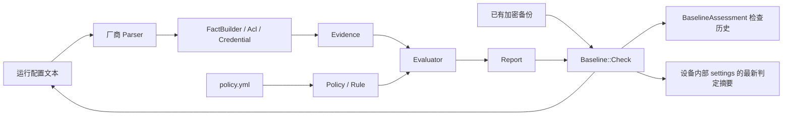

> 本文保留模块从 Motor 提取前的领域设计、覆盖范围、限制与验证记录，供兼容迁移和故障分析使用。
> 当前独立 gem 的安装、依赖、开发与发布入口以 [README-zh.md](../README-zh.md) 为准。
> 涉及 `Motor::*`、`Sync`、`Baseline::Check`、数据库、Rails、Rake 运维任务及私有实机证据的内容均属于 Motor 宿主集成，不随 gem 提供；历史验证记录不代表当前用户设备已经验证。

# 当前独立模块的离线检查与修正

`Audit` 保留 Parser → FactBuilder → Evidence → Evaluator → Report 主链。Parser 同时记录带完整身份、作用域、非秘密属性和来源行的 `ConfigurationResource`；旧地址集合与结构化对象规则分别表达地址和对象合规。

`Remediation` 以同一输入快照和策略调用 Audit，再由领域规划器协调目标集合、引用、认证及容量约束，厂商 `CommandRenderer` 将类型化 `ConfigurationOperation` 呈现为 `CommandStep`。`RemediationPlan` 保留每项启用指标的结果、受阻原因、配置及策略指纹；未知或部分输入不能生成相关操作。命令全部供人工审核，不连接设备、不保存或提交配置，也不在普通输出中导出秘密。

PAN-OS NTP 使用固定主备槽位身份；地址叶子更新保留认证子树，更换认证对端要求外部兼容性证据，呈现器只接受规划器核验后的槽位名单。未知选项阻止整个槽位删除。当前条件能力、未支持项及验证边界以 [指标文档](baseline-metrics.md) 和 `Remediation.capabilities` 为准。

# 历史 Motor 宿主设计

对**已经取得的运行配置文本**进行结构化解析和基线判定。参考 Netstack 的事实、策略、规则和报告划分，在 Motor 中复用 `CtxParser` 的配置树、解析上下文、来源捕获和结果接口。模块不创建设备连接、不执行命令、不触发备份任务，也不生成修复配置。

## 对象与职责



| 对象 | 职责 |
| --- | --- |
| `Audit` | 纯文本入口，选择厂商解析器并组织判定 |
| `Parser < CtxParser::Configuration` | 输入边界、语法提取；通过公共 `analyze` / `capture` 管理逐行状态和来源 |
| `Comware::Parser` / `Cisco::Parser` | 分别共享 Comware/VRP 与 IOS/NX-OS 的语法族 |
| `H3c::Parser` / `Huawei::Parser` / `CiscoIos::Parser` / `CiscoNxos::Parser` / `Hillstone::Parser` / `PaloAlto::Parser` | 厂商差异，不把厂商分支散落到规则求值中 |
| `Document < CtxParser::Document` | 使用公共游标和缩进树，隔离 banner、接口子配置及不完整输入 |
| `MultilineDocument` / `Hillstone::Document` / `PaloAlto::Document` | 隔离跨行字符串、证书和 UI 数据，保留厂商命令边界；注释和 banner 不参与字符串扫描 |
| `FactBuilder` | 每次解析独享的事实集合，归约 VTY、SNMP 组引用、命名 ACL 与原生来源列表、凭据；输出独立的结果快照 |
| `Evidence` | 不可变事实、输入指纹、完整性和局部解析诊断 |
| `Acl` | IPv4 地址区间与有序规则，按首次匹配计算允许来源 |
| `Credential` | 只保留格式、存储类别、明文长度/字符类别/常见弱口令标记 |
| `Policy` / `Rule::Definition` / `Rule` | YAML 批准值、强类型规则目录、适用范围、比较操作、严重度及选择分支 |
| `Evaluator` / `Report` | 四态判定、覆盖率、得分、差异、解析诊断和可读/结构化报告 |
| `Check` | Rails 适配，复核已成功备份的配置，原子保存检查历史与最新判定摘要 |
| `Motor::BaselineAssessment` | 按设备、时间、状态查询不可修改的历史结果，关联来源备份并保存指纹 |

独立 Ruby 调用只需加载 `baseline`；`Check` 由 Rails 自动加载。持久化使用 `baseline_assessments` 表；纯文本分析不依赖数据库。没有新增外部依赖、HTTP 接口或后台任务。

厂商解析器把命令转换为普通 Ruby 值及 `Acl` / `Credential` 对象；`FactBuilder` 不读取命令文本，也不操作游标。语法解释成功后由 `CtxParser::Configuration#analyze` 标记当前行，`capture` 关联脱敏数据与来源；未解释的子命令保留原状态。事实中的行号用于判定报告，游标中的捕获用于显式溯源，两者不将原文带入持久化结果。

新增厂商时，有相同语法族才继承 `Comware::Parser` 或 `Cisco::Parser`；防火墙直接继承 `Baseline::Parser`，独立解释本机管理语法。新增跨厂商归约逻辑放入 `FactBuilder` 或已有领域对象，批准值仍声明在策略 YAML 中。不要在厂商类中重复维护事实字典、诊断列表或引用解析状态。`FactBuilder#record_source_restriction` 对原生允许来源统一归一化，区分 `nil`（未确认）、`[]`（明确没有允许来源）与 `0.0.0.0/0`（全网）；`mark_incomplete!` 使破损声明无法证明合规的缺省状态。

## 事实与检查

默认策略包含 30 项检查，按组织标准修改批准值，不从设备当前值反向生成“标准”。

| 类别 | 结构化事实和检查 |
| --- | --- |
| SNMP | 启用配置、版本、community 与 v3 用户/组写权限、v3 认证/加密、用户/团体 ACL 绑定及批准来源 |
| NTP | 服务器集合、数量、显式认证开关、源接口 |
| Syslog | 服务器集合、数量、源接口 |
| SSH | 启用配置、显式版本、VTY 协议与账户认证；H3C 支持 VTY 类继承 |
| ACL | 定义、引用、首次匹配语义、管理/SNMP 的 IPv4 来源限制 |
| 非必要服务 | Telnet、HTTP、HTTPS、FTP、TFTP、Finger 的显式开关，由策略选择检查项 |
| 凭据 | 本地账号、SNMP、TACACS、line/enable/super 密码的可识别存储格式和可观察强度 |
| TACACS | 服务器、组/模板、密钥配置，管理认证域、默认及命名 AAA 登录列表的实际引用 |

`pass` 表示已知事实符合策略；`fail` 表示确定偏离；`unknown` 表示缺少配置证据、批准值或解析能力；`not_applicable` 表示明确不在适用范围内。得分为通过项占适用项的比例；覆盖率为已判定项占适用项的比例。未知项不会获得分数，全部禁用或全部不适用也不会标为合规。

`complete: true` 是调用方对**完整配置快照**的声明，不代表每个事实都可识别。分页残留、错误回显、未闭合 banner、无 hostname/sysname、非法编码会阻止合规结论。接口或 banner 内看似合法的全局命令不会变成全局事实。

部分配置可以保留已确认且不依赖未见记录的违规：禁用服务开启、意外集合成员、完整输入中可确认的越界管理来源、弱明文凭据、SNMP 写授权及不安全凭据存储。
缺少批准成员、数量不足、其他标量比较仍保持 unknown；部分证据不会产生 pass，报告仍不完整。
明确的上下文不匹配先返回 not_applicable；部分集合的“全部满足/不存在”不能用来判定策略适用范围。
部分输入或分页输入的无终止末行，以及内联分页/错误污染行不进入事实，避免截断密码/地址被当作有效配置；
原 Cursor、checksum 和行号保留。明确完整的无末尾换行配置继续支持。

明确保留的限制：

- 没有显示且未经厂商语义确认的服务默认值保持未知；已确认的例外在对应能力说明中列出，例如 NX-OS SNMP。配置只能证明配置状态，不能证明 SSH 可达、NTP 同步、Syslog 接收或 TACACS 可用。
- NTP 认证检查只检查显式配置，PAN-OS 要求所有已配置服务器的认证方式均可确认；不推断服务器认证成功或算法强度。
- ACL 支持 IPv4 来源、连续通配掩码、IP/TCP/UDP/ICMP、有序首次匹配及目标端口 `eq`（数字或 ssh/telnet/snmp/snmptrap）。VTY 按 SSH/Telnet 监听端口分别归约，SNMP 按请求监听端口归约；没有显式覆盖时使用 TCP 22/23、UDP 161。Comware/VRP 的 SSH、Telnet、SNMP 和 NX-OS 的 SSH 显式端口覆盖会参与计算；IOS rotary 等尚未能确认的映射保持未知，不能按默认端口推导为空来源。trap 的目标端口不作为本机监听端口。多个入口的允许网段合并后再判断是否覆盖全网。支持 Comware 命名 ACL 引用；端口范围、源端口、对象组、复杂目的地址、自动排序和无法确认的服务协议仍保持未知。IPv6 不纳入这些 IPv4 检查。
- Cisco 支持默认及 VTY 显式引用的命名 AAA 登录列表、命名服务器与 TACACS 组；缺失列表或未识别的认证方法保持未知。Comware/VRP 缺少可确认的管理域也返回未知。
- 密文格式不能证明密码强度。受保护存储仍可能对应弱密码；不解密、不破解，也不持久化密文或密码摘要。明文强度只按策略中的长度、字符类别及内置常见弱口令特征判断。
- 原始配置只存在于调用方输入/解析会话及已有的加密备份。调试工具的 `cursor.content` 可显式访问原文，不能写入日志；报告及对象默认序列化不包含原文。

Cisco 密码格式分类参考官方 [Protecting Secrets on Cisco Network Devices](https://www.cisco.com/c/en/us/about/trust-center/resilient-infrastructure/protecting-secrets.html)。这里将存储格式检查与强度检查分开。

### Hillstone 与 Palo Alto

两家厂商使用相同的事实、策略、四态判定和历史持久化接口。路由器的 VTY 和 SSH 版本规则没有防火墙对应证据时保持未知，组织可通过策略的 `applies_to.vendor` 限定适用平台。

| 能力 | Hillstone / StoneOS | Palo Alto / PAN-OS |
| --- | --- | --- |
| 配置格式 | `show configuration` 导出的缩进块及 `exit` | 本机完整 `set` 导出；不解释 XML、花括号或 Panorama 模板展开 |
| 管理访问 | 接口 `manage` 显式服务状态；`admin host` 的 CIDR、掩码、范围及协议来源并集 | MGT 服务与 `permitted-ip`，加上实际绑定到物理/逻辑接口的管理 profile；未绑定 profile 不参与 |
| NTP / Syslog | 去重服务器、可确认的来源、NTP 显式认证 | 主备 NTP、none/autokey/symmetric-key 配置、Syslog server profile、显式 service route 来源 |
| SNMP | manager 状态、v1/v2c 主机权限和来源；trap-host 与轮询来源分离 | v2c/v3 轮询凭据与来源；trap profile 不当作轮询授权 |
| TACACS | 主/备服务器、密钥元数据、管理认证/授权的实际方案引用 | server profile → authentication profile → 系统选择；sequence 按首个认证方式解析 |
| 凭据 | 本地账号、TACACS、SNMP 元数据；未证实的厂商编码保持未知 | phash 元数据、TACACS/SNMP 编码；显式外部认证账号不伪造本地密码 |

Hillstone 省略 `ro/rw` 的合法 SNMP host 声明采用厂商文档规定的只读权限；SNMPv3 用户/组权限尚未建模，保持未知。未声明的管理服务默认值、无法确认的 AAA 引用和存储格式也保持未知。[StoneOS CLI 指南](https://kb.hillstonenet.com/en/wp-content/uploads/2017/11/StoneOS_CLI_User_Guide_Complete_Book_5.5R5-1.pdf)

PAN-OS 管理 profile 未指定 permitted IP 时没有来源限制，因此必须合并 MGT 和所有启用的数据接口入口，不能只用 MGT 白名单证明设备受限；未知绑定或 IPv6 来源不会被当作受限的 IPv4 集合。轮询 SNMP 只支持读取统计，TACACS 授权与命令记账暂不套用路由器语义。[接口管理 profile](https://docs.paloaltonetworks.com/ngfw/networking/configure-interfaces/use-interface-management-profiles-to-restrict-access)、[SNMP 读取语义](https://docs.paloaltonetworks.com/ngfw/administration/monitoring/snmp-monitoring-and-traps/monitor-statistics-using-snmp)

证书、描述及 UI 字符串内的伪命令不会成为事实；未闭合引号、跨行的关键业务值和破损 set 语句阻止合规结论。原生管理列表仍只分析 IPv4，且不把安全策略、区域策略或实际可达性等价为管理允许来源。

### SNMP 写权限证据

`snmp.write_enabled` 检查的是配置授予的写权限：任一已知写授权会得到 `fail`；所有授权均明确只读才会通过；缺失组引用、未知角色或不能完整解释的组语法保持 `unknown`。一个授权未知不会抹掉另一个已确认的写授权，也不会阻断 SSH 等无关检查。写视图声明不等于已经成功执行 SNMP SET，MIB 对象可写性、网络可达性和运行时认证需要另行验证。

默认策略在 `snmp.enabled: true` 时执行写权限检查，因此纯 SNMPv3 配置也纳入检查，不能仅以 community 是否存在决定规则范围。

- IOS/IOS-XE 解析 v3 组的 `write`，H3C/VRP 解析 `write-view`。只有完整识别的组语法才使用“未声明写视图即无写授权”的厂商语义。同名组不同安全级别的权限合并，后一个只读定义不会覆盖先前的写授权。来源行号包含组定义。
- IOS 的认证/加密 SNMPv3 用户可能不在 running-config 中显示，因此组写授权直接参与配置基线，不以“没有可见用户”推断没有写权限，也不凭组定义伪造认证用户。
- NX-OS 解析显式 SNMP 用户的 `network-admin` / `vdc-admin` 写权限与 `network-operator` / `vdc-operator` 只读权限。多角色取权限并集；自定义角色暂不从名称推断权限，角色单独追加也不会清空此前解析的认证配置。
- NX-OS 默认启用 SNMP；`no snmp-server protocol enable` 明确禁用后，默认写权限规则不适用。CLI 与 SNMP 账号通常同步，但存在密钥形式和版本差异；CLI 账号或角色没有对应的显式 SNMP 用户证据时，写权限覆盖保持 `unknown`，不会生成推测的 SNMP 用户。显式 `snmp-server disable snmp-aaa sync` 可解除该同步覆盖疑问；已知写授权仍优先判定违规。配置分析不声称覆盖未出现在配置中的远端 AAA 会话用户。

语义依据：[Cisco IOS SNMP 命令参考](https://www.cisco.com/c/en/us/td/docs/ios-xml/ios/snmp/command/nm-snmp-cr-book/nm-snmp-cr-s5.html)、[Cisco NX-OS RBAC](https://www.cisco.com/c/en/us/td/docs/dcn/nx-os/nexus9000/103x/configuration/security/cisco-nexus-9000-nx-os-security-configuration-guide-103x/m-configuring-user-accounts-and-rbac.html)、[NX-OS SNMP 与账号同步](https://www.cisco.com/c/en/us/td/docs/switches/datacenter/nexus9000/sw/104x/config-guides/cisco-nexus-9000-series-nx-os-system-management-configuration-guide-release-104x/m-configuring-snmp-10x.html)、[H3C SNMP 命令参考](https://www.h3c.com/en/Support/Resource_Center/EN/Home/Public/00-Public/Technical_Documents/Reference_Guides/Command_References/H3C_CR-24948/13/202601/2739237_294551_0.htm)、[Huawei SNMP 命令参考](https://info.support.huawei.com/enterprise/zh/doc/EDOC1100459421/dab469bd)。新增回归均为合成语法，不代表新增实机认证。

## 策略

默认文件为本目录 `policy.yml`。组织批准的 NTP/Syslog/TACACS 服务器、源接口和管理网段初始为 `null`，因此对应项返回 `unknown`。

```yaml
version: 1
checks:
  ssh.enabled:
    expected: true
    severity: high
  ntp.servers:
    expected:
      by_site:
        example_site: [192.0.2.10, 192.0.2.11]
      default: null
  management.sources:
    expected: [198.51.100.0/24]
  credentials.strength:
    expected: {min_length: 12, min_classes: 3}
    applies_to: {facts: {credentials.present: true}}
  services.disabled:
    expected: [telnet, http, ftp, tftp]
```

示例地址仅用于文档。自定义策略只包含其中声明的检查，不自动合并默认文件。单项可设 `enabled: false`；严重度支持 `low/medium/high/critical`。

`expected` 支持 `by_host > by_model > by_site > by_role > by_vendor > default`，按字符串精确匹配，也支持嵌套。高优先级选择器缺少上下文时保持未知；命中的值为 `null` 时不落到低优先级值。`applies_to` 支持同样的上下文及 `facts` 条件，多个条件需同时满足。

上下文条件只接受非空白字符串或非空、扁平字符串数组。事实条件只允许 `Rule::APPLICABILITY_FACTS` 中的布尔/字符串事实，按相等或备选值匹配；拼错事实名、空数组、嵌套数组和类型错误直接拒绝，避免错误跳过检查。版本和服务列表限定目录中的枚举且不能为空；服务器/来源集合允许 `[]` 表达明确要求没有服务器或不允许任何来源。`null` 始终表示尚未定义批准值。

仅接受单个 YAML 文档，拒绝重复键、别名、任意对象、未知规则和无效类型。`vendor` 使用解析器规范名：`h3c`、`huawei`、`cisco_ios`、`cisco_nxos`、`hillstone`、`palo_alto`。入口接受 `stoneos` / `stone_os` 与 `paloalto` / `panos` / `pan_os` 等别名，策略统一使用规范名。业务批准值仍由组织填写，真实备份用于完善语法支持，不自动成为批准值。

## 调用

在 `backend` 目录下，独立 Ruby 调用不加载 Rails、Netstack 或 net-connector：

```ruby
require "baseline"

policy = Baseline::Policy.default
report = Baseline::Audit.new(policy: policy).call(
  configuration: File.binread("/secure/device.cfg"),
  platform: "cisco_nxos", complete: true,
  context: {host: "192.0.2.1", site: "example_site", role: "leaf_switch"}
)
report.to_h       # 脱敏后的完整结构化事实与判定
report.to_text    # 可读原因、实际/预期值、集合差异、策略分支与来源行号
report.summary    # 紧凑的判定摘要
report.compliant? # 仅在所有适用检查都确定通过时为 true
```

Rails console 中评估已有备份：

```ruby
device = Motor::Device.find(123)
result = Baseline::Check.new.call(device: device, context: {site: "example_site"})
result.report
result.revision
device.reload.motor_settings.dig("baseline", "latest")
device.baseline_assessments.latest_first.first # 最近一次结果
device.baseline_assessments.fail.latest_first # 历史偏离记录
```

默认取设备最新创建的成功备份，可传 `backup_id:` 精确选择。`Check` 校验备份归属、host、状态、完成时间和 SHA-256；厂商由设备 OS/vendor 判断，身份上下文取自设备，外部只可补充 `site`。

`baseline_assessments` 保存 `pass/fail/unknown` 状态、修订号、检查时间、平台、上下文、策略/配置 SHA-256、紧凑报告及设备/备份关联。它表示已经完成的离线判定；执行异常不写成配置不合规，也不覆盖上次结果。历史记录不可通过模型更新或删除；外键保证备份属于同一设备，并在历史存在时阻止删除设备和来源备份。创建历史时锁内核对备份成功状态、完成时间、设备身份与内容指纹；已关联历史的备份身份、配置、指纹和状态不能通过模型改写。表不开放 RailsAdmin 通用 CRUD。

`devices.settings['_motor']['baseline']` 继续保存最新摘要、来源备份 ID/指纹、策略指纹、检查时间和修订号，两处在同一事务内提交。完整 ACL、账号、实际/预期值和大诊断数组不重复持久化，以遵守原有 64 KiB settings 限制。完整报告通过当前调用的 `result.report` 导出，历史保留判定摘要，不保存原始配置副本。

相同来源、策略、上下文和判定重跑不增加修订号或历史行。旧 settings 摘要在下次可信重查时补历史，不伪造过去的检查。`expected_revision:` 可拒绝旧请求；计算在锁外，写入前在锁内再次检查设备版本和备份，冲突抛出 `SourceChanged`，不覆盖新结果。来源不可信抛出 `InvalidSource`；历史插入或 settings 写入失败都会回滚，保留原结果。

命令入口：

```sh
bundle exec rake 'motor:baseline:file[/secure/device.cfg,cisco_nxos,,true]'
bundle exec rake 'motor:baseline:check[123]'
bundle exec rake 'motor:baseline:check[123,/secure/baseline.yml]'
bundle exec rake 'motor:baseline:file[/secure/device.cfg,h3c,/secure/baseline.yml,true,/secure/context.json,json]'
bundle exec rake 'motor:baseline:check[123,/secure/baseline.yml,/secure/site.json,json]'
bundle exec rake 'motor:baseline:catalog'
bundle exec rake 'motor:baseline:validate[/secure/baseline.yml]'
```

`context.json` 是普通 JSON 对象，例如 `{"host":"192.0.2.1","site":"example_site","role":"leaf_switch"}`。文件分析支持 host/model/site/role，vendor 由平台确定；备份检查的 `site.json` 只允许 `{"site":"example_site"}`，设备身份来自数据库。上下文文件上限 16 KiB；持久化上下文还受模型 4 KiB 限制。

本地文件任务默认视为不完整，必须明确传 `true`。文件任务不保存检查结果；备份任务保存历史及最新摘要。命令默认输出可读状态，不打印配置或凭据；`json` 输出单个完整 JSON 文档供自动化使用，保存元数据位于 `persistence`。合规退出 `0`，不合规/未知退出 `2`，输入或执行错误退出非零。`catalog` / `validate` 也接受最后一个 `human|json` 参数；策略校验仅确认结构和类型，不代表批准值齐全或设备合规。

## 数据库部署

先备份数据库，再随正常发布执行 `RAILS_ENV=production bin/rails db:migrate`，之后部署使用新表的检查入口。迁移只增加历史表、关联约束及索引，不读取或迁移原始配置，也不批量重算旧结果。应用回滚可保留新增表；数据库回滚会删除检查历史，需先导出需要保留的结果。

## 验证

```sh
RAILS_ENV=test bundle exec rspec spec/vendor/baseline spec/models/baseline_assessment_spec.rb
bundle exec rubocop vendor/baseline lib/tasks/baseline.rake app/models/motor/baseline_assessment.rb spec/vendor/baseline spec/models/baseline_assessment_spec.rb
RAILS_ENV=test bin/rails zeitwerk:check
```

合成样本使用保留地址和虚构凭据。测试覆盖六种解析平台、规则范围与缺失值、ACL 顺序与别名冲突、原生来源列表、SNMP 权限、凭据脱敏、解析会话隔离、独立加载、加密备份、重复执行、检查期间设备/配置变化以及持久化失败。离线回放只验证配置解析与判定，不代表设备连通性或运行状态。

2026-10-16 重新核对用户提供的 `net-connector/examples/backups/2026-10-14_13-57-02`：manifest 共 981 条，973 条成功、8 条失败；目录另有 1 个不在成功 manifest 中的文件，未纳入可信回放。每份成功记录均核对 SHA-256。支持的 964 份（H3C/无线 858、NX-OS 83、IOS 1、Hillstone 20、Palo Alto 2）均完成结构解析；Radware 8、Centec 1 仍明确为 unsupported。原有 942 份的完整判定报告与本轮变更前一致。这里校正旧文档将目录文件数当作成功备份数的统计。

两家新增厂商的 NTP/Syslog/TACACS 来源还通过独立命令语法提取核对，共 66 组集合比较、零差异。结构解析完成不表示基线合规：未知缺省值、缺少组织批准值或未覆盖语法继续返回 unknown。原有 H3C 目标端口适配将管理 ACL 无法解析的配置由 240 份减少到 1 份的结果保持不变。

ACL 首次匹配计算使用地址边界扫描和优先级堆，避免逐条区间减法的平方增长。真实 1,382 个小 ACL、4,146 个查询与旧实现完全一致，耗时基本持平；4,000 条规则的合成压力样本显示显著改善，不能将合成提速比例当作整批设备提速。回归另用 46,080 个独立逐地址判定验证首次匹配语义。

真实备份未复制进仓库或导入业务库；回归只保留脱敏的合成语法。新增平台应先提供完整语法及正反例，再接入 `Audit::PARSERS`，不按相似命令猜测整个平台兼容性。
